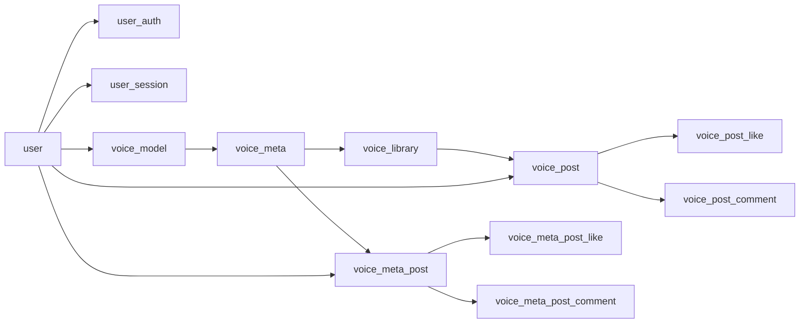

# EarDo 数据库分析说明

> 注意：本地导出的数据库包含用户资料、认证哈希、会话、音频二进制等敏感数据。不要提交到 Git，不要发到公开群，不要截图展示手机号、邮箱、`credential`、`session_token` 或完整用户 ID。

## 导出文件位置

本次生产库已从新服务器 `143.198.194.152` 导出到本地：

```text
db_exports/eardo_prod_20260612_200656/
```

该目录已被 `.gitignore` 忽略。主要文件：

| 文件 | 用途 |
|---|---|
| `eardo_prod.dump` | PostgreSQL custom dump，可用 `pg_restore` 还原 |
| `schema.sql` | 仅数据库结构，适合先看表、字段、约束 |
| `restore.list` | dump 内对象清单 |
| `columns.tsv` | 表字段摘要 |
| `table_counts.tsv` | 每张业务表的行数 |
| `voice_library_bytes.txt` | 音频二进制总字节数 |
| `SHA256SUMS.local.txt` | 本地文件 SHA256 校验 |

本次导出关键统计：

| 表 | 行数 | 含义 |
|---|---:|---|
| `user` | 30 | 用户资料 |
| `user_auth` | 21 | 邮箱/手机号登录认证记录 |
| `user_session` | 40 | 登录会话记录 |
| `voice_model` | 117 | 声音模型 |
| `voice_meta` | 305 | 调声参数/元数据 |
| `voice_library` | 219 | 生成语音库，含 `audio_data` 音频二进制 |
| `voice_post` | 25 | 语音作品帖子 |
| `voice_post_like` | 26 | 语音作品点赞 |
| `voice_meta_post` | 9 | 声音参数分享帖 |

`voice_library.audio_data` 当前总大小：`146808870` 字节。

## 快速查看结构

不需要还原数据库时，先看这三个文件：

```powershell
notepad .\db_exports\eardo_prod_20260612_200656\schema.sql
notepad .\db_exports\eardo_prod_20260612_200656\columns.tsv
notepad .\db_exports\eardo_prod_20260612_200656\table_counts.tsv
```

重点关系：



## 还原到本地 PostgreSQL

如果本机已安装 PostgreSQL 16 客户端和服务端：

```powershell
createdb -U postgres eardo_analysis
pg_restore -U postgres --clean --if-exists --no-owner --dbname=eardo_analysis .\db_exports\eardo_prod_20260612_200656\eardo_prod.dump
psql -U postgres -d eardo_analysis
```

如果没有本地 PostgreSQL，可以用 Docker：

```powershell
docker run --name eardo-db-analysis -e POSTGRES_PASSWORD=postgres -e POSTGRES_DB=eardo_analysis -p 5434:5432 -d postgres:16
docker cp .\db_exports\eardo_prod_20260612_200656\eardo_prod.dump eardo-db-analysis:/tmp/eardo_prod.dump
docker exec -it eardo-db-analysis pg_restore -U postgres --clean --if-exists --no-owner --dbname=eardo_analysis /tmp/eardo_prod.dump
docker exec -it eardo-db-analysis psql -U postgres -d eardo_analysis
```

分析结束后可以停止容器：

```powershell
docker stop eardo-db-analysis
docker rm eardo-db-analysis
```

## 常用分析 SQL

### 用户与认证

不要直接导出 `provider_id` 或 `credential` 给别人。需要统计时只做聚合：

```sql
select auth_type, count(*)
from user_auth
group by auth_type
order by auth_type;

select count(*) as users_without_auth
from "user" u
left join user_auth a on a.user_id = u.id
where a.id is null;

select count(*) as active_sessions
from user_session
where expires_at > now();
```

### 语音生成数据

```sql
select count(*) as voice_count,
       pg_size_pretty(sum(octet_length(audio_data))::bigint) as audio_size
from voice_library;

select date_trunc('day', created_at) as day,
       count(*) as generated_count
from voice_library
group by day
order by day desc;

select m.name as voice_model_name,
       count(l.id) as generated_count
from voice_library l
join voice_meta meta on meta.id = l.voice_meta_id
join voice_model m on m.id = meta.voice_model_id
group by m.name
order by generated_count desc;
```

### 帖子与互动

```sql
select title, likes_count, comments_count, created_at
from voice_post
order by likes_count desc, created_at desc
limit 20;

select title, likes_count, comments_count, created_at
from voice_meta_post
order by likes_count desc, created_at desc
limit 20;
```

### 数据完整性检查

```sql
select count(*) as orphan_auth
from user_auth a
left join "user" u on u.id = a.user_id
where u.id is null;

select count(*) as orphan_voice_library
from voice_library l
left join voice_meta m on m.id = l.voice_meta_id
where m.id is null;

select count(*) as orphan_voice_post
from voice_post p
left join voice_library l on l.id = p.library_id
where l.id is null;
```

## 表怎么理解

- `user`：用户基础资料，`avatar` 是头像二进制。
- `user_auth`：登录凭据，`auth_type` 区分邮箱/手机号，`provider_id` 是邮箱或手机号，`credential` 是密码哈希，不要明文展示。
- `user_session`：登录会话，`id` 相当于 cookie token，`expires_at` 决定是否有效。
- `voice_model`：可用声音模型，既有系统内置模型，也可能有关联用户的克隆/设计模型。
- `voice_meta`：一次调声配置，包括音高、语速、音量、指令等。
- `voice_library`：生成出的音频，`audio_data` 是 MP3 二进制，`text_content` 是生成文本。
- `voice_post` / `voice_meta_post`：发布出来的作品/调声参数分享。
- `*_like` / `*_comment`：点赞和评论关系表。

## 安全处理建议

- 分析结果只导出聚合数据，避免导出手机号、邮箱、密码哈希、session ID。
- 如果需要给别人发样例，先脱敏：用户 ID 只保留前 8 位，邮箱/手机号替换成编号。
- 不要把 `db_exports/` 目录加入 Git。
- 不要在生产库上直接跑重查询；分析请使用本地还原库。
